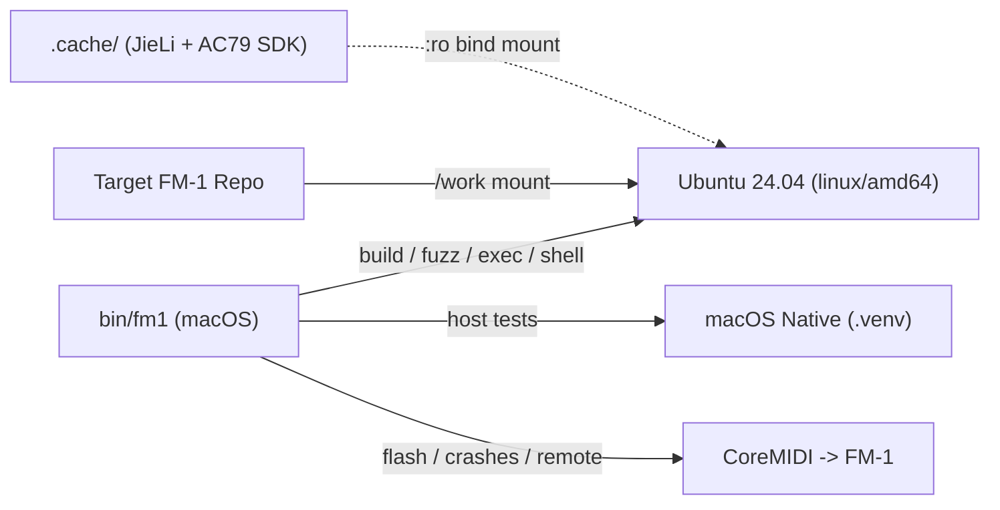

# FM1 Vibe Kit


A universal macOS + container Layer 1 dev-environment kit for building, testing, flashing, and debugging custom M-VAVE FM-1 firmware.

Built for the common open-source FM-1 stack centered on [`felucca-bsp`](https://github.com/hugelton/felucca-bsp) and [`fm1-base`](https://github.com/charlesvestal/fm1-base), with `fm1 exec` and `fm1 shell` supporting any FM-1 firmware lineage (`sloop-fm1`, `dinghy`, or raw AC79 C).

This kit does not ship a pre-built synth firmware; instead, it gives you the complete, verified build, fuzz, flash, and debug environment so you can take any FM-1 firmware project or custom instrument idea and run with it from day one.

## Prerequisites (macOS / Apple Silicon)

- **Xcode Command Line Tools:** `xcode-select --install`
- **Container runtime:** [OrbStack](https://github.com/orbstack/orbstack) or [Docker Desktop](https://docs.docker.com/get-docker/) (`linux/amd64` support)
- **Optional VM / Sandbox tools:**
  - [Tart](https://github.com/openai/tart) (`/opt/homebrew/bin/tart`) for clean macOS/Linux VM snapshots
  - [Vibe](https://github.com/lynaghk/vibe) (`~/.local/bin/vibe`) for lightweight command/agent sandboxing

## Quickstart

```sh
# 1. Check host prerequisites (read-only)
./bin/fm1 doctor

# 2. Bootstrap local .venv, JieLi toolchain/SDK cache, builder image, and felucca-bsp
#    (or choose: --starter fm1-base | dinghy | fm1-open, --clone <url>, --repo <path>, --no-starter)
./bin/fm1 setup

# 3. Verify everything is green (auto-detects ./workspace/* if --repo is omitted)
./bin/fm1 doctor

# 4. Run any custom command or interactive shell inside the linux/amd64 container
./bin/fm1 exec -- sh -c 'test -x "$JIELI_TOOLCHAIN/common/bin/clang" && echo ok'
./bin/fm1 shell

# 5. For felucca-bsp / fm1-base app layouts: test, build, flash, and inspect crashes
./bin/fm1 test --repo ~/dev/my-fm1-fw --fuzz 8
./bin/fm1 build --repo ~/dev/my-fm1-fw
./bin/fm1 flash --repo ~/dev/my-fm1-fw --dry-run
./bin/fm1 flash --repo ~/dev/my-fm1-fw --yes
./bin/fm1 crashes --repo ~/dev/my-fm1-fw
```

See [`docs/NEXT-STEPS.md`](docs/NEXT-STEPS.md) for your first 5-minute win and starter vibe-coding prompts. You can also export `FM1_REPO_DIR=~/dev/my-fm1-fw` instead of passing `--repo` on every command.

## Architecture & Host/Container Boundary

| Concern | Where It Runs | Why |
|---|---|---|
| JieLi `x86_64` firmware builds (`fm1 build` / `fm1 exec`) | `linux/amd64` Ubuntu 24.04 container | JieLi toolchain binaries are `x86_64` Linux ELFs |
| ASan/UBSan fuzzing (`tests/run_fuzz.sh`) | `linux/amd64` Ubuntu 24.04 container | macOS `sem_init()` is a stub returning `ENOSYS` |
| Host test suite (`tests/run_tests.sh`) | Native macOS | Fast (~15s) feedback on DSP, UI, and state migrations |
| Flashing & remote control (`fm1_install.py`, `fm1_remote.py`) | Native macOS (`.venv`) | Uses CoreMIDI directly without fragile USB-MIDI VM passthrough |



## Supply-Chain & Licensing Policy

- All external inputs (Ubuntu digest, JieLi toolchain SHA256, AC79 SDK commit SHA, Python package versions) are pinned in `pins.env`.
- `fm1 setup` downloads the JieLi toolchain and AC79 SDK locally into `.cache/` (never `curl | tar`), verifies checksums/commit SHAs, and bind-mounts them read-only (`:ro`) into the container at runtime.
- Proprietary JieLi toolchain binaries and AC79 SDK files are **never** committed to git or baked into Docker image layers.
- Run `./bin/fm1 clean` (or `./bin/fm1 clean --all` to also remove the local Docker image) to wipe local caches.

## License

`FM1-vibe-kit` is licensed under the [MIT License](LICENSE). Third-party tools downloaded locally by `fm1 setup` (including the JieLi Linux toolchain and AC79 SDK) remain governed by their respective upstream terms.
